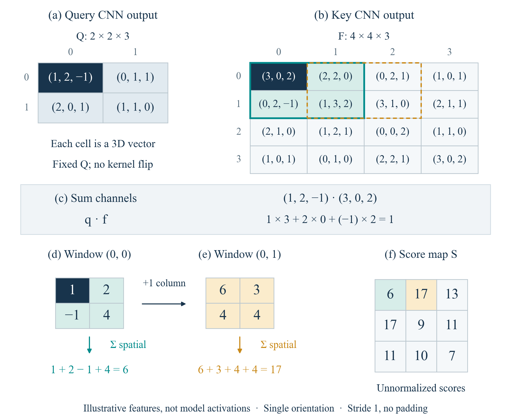

# Transporter Networks 教学复现教程

**基于 [Transporter Networks（Zeng et al., CoRL 2020）](https://transporternets.github.io/) 与官方 [google-research/ravens](https://github.com/google-research/ravens) 的非官方教学整理。** 本项目继承原方法与官方实现，补充可搬迁的复现入口、中文教程、数值算例和模型诊断可视化。Transporter 的模型结构、算法思想、仿真任务与预训练权重均归原作者；本项目不将这些工作作为原创算法。

面向有深度学习基础、希望把公式与机器人抓放过程联系起来的研究生。默认使用官方预训练模型，**无需自行训练**。

> 当前可执行范围：Ubuntu 22.04 / Python 3.10 / CPU，单个 `block-insertion` 任务，10 条训练示范、3 条测试示范、官方 10,000 步检查点。GPU、其他任务和完整论文基准不在已验证范围内。

## 从哪里开始

| 目标 | 入口 |
| --- | --- |
| 第一次运行：安装、下载小子集、评估、排查问题 | [完整复现教程](docs/tutorial.zh-CN.md) |
| 按精修稿理解公式、图和代码 | [教学内容与代码映射](docs/teaching-map.zh-CN.md) |
| 阅读整合后的章节 | [《具身操作泛化》精修稿 PDF](docs/具身操作泛化_精修稿_20261011.pdf) |
| 区分历史结果、本轮验证和未验证内容 | [验证记录与实验边界](docs/results.md) |
| 核对继承关系、引用与素材许可 | [来源与贡献说明](NOTICE.md)、[引用文件](CITATION.cff) |

精修稿包含对 VLA、世界模型等后续方向的讨论；本仓库实现的复现与实验补充围绕 Transporter/Ravens。阅读材料的覆盖面不代表代码已经复现全部被讨论的方法。

## 继承了什么，补充了什么

| 部分 | 来源与本项目处理 |
| --- | --- |
| 抓取/条件放置、Query/Key 网络、全图交叉熵 | Zeng 等原论文与官方 Ravens 实现；不改写网络算法 |
| 机器人、物体资产、任务奖励、专家示范 | 官方 Ravens；安装时从固定源码版本获取 |
| 预训练权重与 `block-insertion` 示范 | 官方公开存储；只按需下载选定成员，不重新分发整套数据 |
| Python 3.10 / TF 2.15 CPU 环境与运行入口 | 本项目整理、固定依赖并进行通路验证 |
| 四答案/MSE、三通道互相关、Softmax 梯度 | 本项目教学算例；人工数值或自由变量优化，不等同于机器人基准 |
| 抓点条件、平移相位、局部输入敏感性 | 对官方预训练模型的教学诊断；不更新模型权重 |

上游固定版本：[`4752ffab487ebd387781ad7890aa540ae2780970`](https://github.com/google-research/ravens/tree/4752ffab487ebd387781ad7890aa540ae2780970)。运行时下载到 `upstream/`，保留原版权头与 Apache-2.0 许可证；本仓库不复制整套上游代码。

## 预训练模型快速运行

以下命令面向 Linux Bash；请使用 Python 3.10。先准备 Python 的 `venv` 支持和 C/C++ 构建工具，具体依赖见完整教程。

```bash
git clone https://github.com/PeterYanZH/transporter-networks-tutorial.git
cd transporter-networks-tutorial
bash scripts/setup.sh
bash scripts/fetch_source.sh
bash scripts/fetch_assets.sh
bash scripts/check_environment.sh
bash scripts/eval_pretrained.sh
```

安装只写入项目的 `.venv/` 与 `upstream/`。数据入口默认选择 10 个训练回合、3 个测试回合和两份官方权重，选中压缩内容约 **121.6 MB**、展开约 **286.6 MB**。通过 HTTP Range 提取所需 ZIP 成员，不自动回退为下载全部任务。网络重试与索引读取会产生额外流量。

评估结果保存在 `results/eval_pretrained.json`，日志保存在 `logs/`。历史 CPU 验证在种子 1、3、5 上各获得奖励 1.0；这是 **3 个场景的通路检查**，不能据此推断总体成功率或复现论文的多任务统计结果。

训练流程检查是独立的可选操作：

```bash
bash scripts/smoke_train.sh
```

该入口只进行一轮监督更新（抓取、放置网络各一次优化器更新），随后保存并重新加载至独立 `smoke_run/`。不会覆盖官方预训练权重；一次更新的损失不用于判断训练收敛。

## 从内积看到动作评分



每个格点保存一个三维特征向量。先沿通道做对应内积，再将窗口内四个内积求和：第一个窗口得 6，向右一格得 17。图中使用人工特征值，展示算子的计算过程；不是从网络读取的激活，也不是动作成功概率。

```bash
source env.sh
# 只计算合成算例，不需要模型、数据或绘图字体
python teaching/scripts/toy_experiments.py --out teaching/toys --no-plots
# 重绘三通道匹配示意
python teaching/scripts/plot_sliding_correlation.py --root teaching
```

正式配图使用 Times New Roman，仓库不分发字体文件。绘图需系统已安装该字体，或通过 `--font-dir` 指向自己有使用权的字体目录；也可显式使用 `--font-family "Liberation Serif"`，其效果与正式图的字形会不同。不会静默替换字体。

预训练模型的教学诊断：

```bash
source env.sh
python teaching/scripts/model_diagnostics.py --project-root . --out teaching
python teaching/scripts/plot_diagnostics.py --root teaching
python teaching/scripts/plot_rollouts.py --root teaching
python teaching/scripts/plot_toys.py --root teaching
```

这会重新运行既定三个场景及条件变化分析，覆盖 `teaching/` 下的同名输出。历史基线保存在 `evidence/historical/`，与可重新生成的教学文件分开保存。已有数组时只运行绘图命令即可。

## 仓库结构

```text
docs/                  中文教程、精修稿、代码映射、结果边界
scripts/               环境、源码/资产下载、评估与可选训练检查
teaching/scripts/      合成实验、模型诊断、绘图
teaching/toys/         小型合成数组与结果
teaching/results/      可重绘的模型数组与指标
teaching/figures/      本项目教学图
evidence/historical/   历史验证基线
tests/                 无模型下载的离线检查
upstream/              运行时获取的官方源码（不提交）
data/, checkpoints/    按需下载的数据、权重（不提交）
```

离线检查入口：`python3 -m unittest discover -s tests -v`。它不下载模型、不执行机器人训练；其通过也不代表完整模型环境已经验证。

## 引用与许可

使用 Transporter 方法或官方实现时，应引用原论文：

```bibtex
@inproceedings{zeng2020transporter,
  title={Transporter Networks: Rearranging the Visual World for Robotic Manipulation},
  author={Zeng, Andy and Florence, Pete and Tompson, Jonathan and Welker, Stefan
    and Chien, Jonathan and Attarian, Maria and Armstrong, Travis and Krasin, Ivan
    and Duong, Dan and Sindhwani, Vikas and Lee, Johnny},
  booktitle={Conference on Robot Learning},
  year={2020},
  url={https://arxiv.org/abs/2010.14406}
}
```

如使用这里的教程、代码组织或补充算例，请另外注明本教学仓库及所用提交版本。代码与新增教程文本采用 [Apache-2.0](LICENSE)，原上游与第三方版权声明保留。精修稿 PDF、其中引用的论文插图和外部数据/模型不因随本仓库发布而被重新许可，具体范围见 [NOTICE.md](NOTICE.md)。
