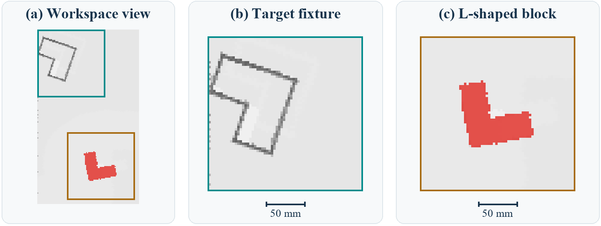

# 第九章泛化技术教学实验题

**主实验：用官方预训练 Transporter 策略完成 L 形积木插入。** 你需要回答：策略如何从同一张桌面观测中选出抓取点，再根据所选抓点决定放在哪里、转多少，最后完成一次装配？

面向有深度学习基础的研究生。使用 CPU、官方 10,000 步检查点和一个 `block-insertion` 小任务。第 1–8 题为必做，最后的单步训练为选做。在线题面与[打印版 PDF](labs.zh-CN.pdf)内容相同；环境问题参见[复现教程](tutorial.zh-CN.md)。



*图 1　主实验的一个初始观测。右侧两个局部视图使用相同的放大比例；图像只用于介绍场景，不包含策略的预测位置。*

## 实验主线

| 顺序 | 要解决的问题 | 留给下一题的证据 |
| --- | --- | --- |
| 1 | 预训练策略在三个场景中怎样执行？ | 基线记录、动作张量约定、种子 1 的追踪对象 |
| 2 | 为什么用空间分布表示动作？ | 四标签的均值、合法区域、候选分布 |
| 3 | 给定抓点，如何产生放置分数？ | 手算的通道内积、完整的互相关评分图 |
| 4 | 示范标签怎样改变全图分数？ | 梯度推导、差分校验、对多峰的解释 |
| 5 | 只换抓点，放置峰为什么移动？ | 同一观测的三抓点表和固定模型数组 |
| 6 | 移动输入后，峰位和分布是否一起移动？ | 人工算子对照、真实模型平移对照 |
| 7 | 两个分支的特征分别依赖哪些输入？ | 裁剪内外梯度统计、支持域分析 |
| 8 | 哪些结论能由本次主实验证明？ | 带来源的闭环报告与证据边界 |

全程区分三种实验单位：**合成数值算例、同一观测上的模型诊断、仿真中的真实执行**。记录失败和偏差，用证据说明判断过程；结果不必和历史数值逐位一致。

## 实验准备

在 Linux 或 Ubuntu WSL2 中运行，使用 Python 3.10。已有仓库和已验证环境时，复用它们并重新做环境、资产检查。资产入口只选取 10 条训练示范、3 条测试示范和两份权重；训练示范只在选做题中用于更新模型。

```bash
git clone https://github.com/PeterYanZH/transporter-networks-tutorial.git
cd transporter-networks-tutorial
bash scripts/setup.sh
bash scripts/fetch_source.sh
bash scripts/fetch_assets.sh
bash scripts/check_environment.sh
```

下列命令设定本题单的工作目录。换终端后，在仓库根目录重新执行这一段。数值与诊断结果放在仓库旁边，便于和随仓历史记录区分。

```bash
source env.sh
LAB="$PWD/../transporter-lab-work"
mkdir -p "$LAB/baseline"
FONT_ARGS=()
# 若系统未安装 Times New Roman，指定自己有权使用的字体目录：
# FONT_ARGS=(--font-dir /path/to/authorized/fonts)
```

绘图与 `model_diagnostics.py` 默认需要 Times New Roman；只做数值的入口不需要绘图字体。若暂时不能运行模型或绘图，可用[随仓数组](../teaching/results/)完成读数和分析，提交时标注“复用记录”，并把未运行的步骤列出来。

## 第 1 题｜跑通主实验：从观测到一次抓放

**任务。** 建立后续各题共同使用的预训练基线。实验单位为一个测试场景，三个种子分别记录。

```bash
bash scripts/eval_pretrained.sh
cp results/environment.json results/assets.json "$LAB/baseline/"
cp results/eval_pretrained.json logs/eval_pretrained.log "$LAB/baseline/"
```

1. 核对可见 GPU 数、场景重置状态、资产校验状态、模型名、检查点步数和三个测试种子。对照日志与 JSON，记录每个场景的奖励、结束状态和执行动作次数。若一个场景有多条日志，区分累计奖励与逐动作记录，并说明 `Done=True` 是否足以判断成功。
2. 阅读固定版本 `upstream/ravens/agents/transporter.py` 的 `get_image()` 与 `act()`，画一张从 RGB-D 到 `pose0`、`pose1` 的流程图。在图上标出融合输入、抓取图、放置评分体的形状，以及各自取最大值的范围。说明为什么先选抓点、再选放置，不等于穷举联合抓放动作。
3. 写出图像 `(r,c)` 对应的世界平面坐标轴、像素间距，以及放置方向索引到执行偏航角的换算。后续固定追踪种子 1，并说明 `10,000` 指哪一次训练的步数。

**交付。** 基线表、带尺寸的流程图、`baseline/` 中的运行记录。种子 1 的具体抓放坐标在第 5 题补齐。

## 第 2 题｜动作表示：四个可行点的均值可行吗？

**承接。** 第 1 题的策略输出空间分数，而不是直接回归一个二维坐标。用一个固定观测的合成例子判断两种表示有什么区别。

在 $41\times41$ 网格上，四个等频专家标签的 $(x,y)$ 为 $(10,10)$、$(30,10)$、$(10,30)$、$(30,30)$。合法区域是以四点为圆心、半径 3 像素的圆盘并集。这里的 $(x,y)$ 是网格绘图坐标。

1. 推导单个坐标预测的平方误差最优解。把最优点画在四个圆盘上，计算它到最近合法圆心的距离，给出可行性判断。
2. 用同一组标签做自由网格 logits 的分类拟合。记录四个标签上的概率和整个合法区域的概率质量，画出分类热图。解释“同一输入允许多种动作”与“一次执行选择一个动作”的关系。
3. 思考：如果一角的示范频率提高，而其余三角均分剩余频率，坐标回归的最优点如何移动？给出一组使均值进入合法圆盘的频率，说明这为什么不推翻第 2 小题的观察。

先完成推导，再用脚本核对。下面的第一条命令同时生成第 4、6 题所需数组；自由变量优化不涉及机器人网络参数。

```bash
python teaching/scripts/toy_experiments.py --out "$LAB/synthetic/toys" --no-plots
python teaching/scripts/plot_toys.py --root "$LAB/synthetic" "${FONT_ARGS[@]}"
```

**交付。** 一张四岛对照图、两种预测的解释、`toy_metrics.json` 中 `multimodal` 的关键字段。说明这个比较为何不能当作公平的网络性能消融。

## 第 3 题｜条件匹配：把 Query 与 Key 变成一个分数

**承接。** 第 2 题需要为多个位置保留分数。本题规定抓点和方向不变，构造一个最小的放置评分图。

每个格子是一组三通道**人工特征**。给定下列 Query $Q$ 和 Key 特征图 $F$，步长为 1，采用 valid 窗口，不翻转 Query。

```text
Q:
(1,2,-1)  (0,1,1)
(2,0, 1)  (1,1,0)

F:
(3,0, 2)  (2,2,0)  (0,2,1)  (1,0,1)
(0,2,-1)  (1,3,2)  (3,1,0)  (2,1,1)
(2,1, 0)  (1,2,1)  (0,0,2)  (1,1,0)
(1,0, 1)  (0,1,0)  (2,2,1)  (3,0,2)
```

1. 对左上窗口和右移一格的窗口，逐格写出三个通道的乘积与通道内积，再对四个格子的内积求和。分别提交两张 $2\times2$ 内积表和两个标量分数。
2. 用 NumPy 独立实现滑动互相关，输出完整 $3\times3$ 分数表，列出**全部**最大值的位置。说清楚一个标量由哪些轴求和得到，以及它与概率的区别。
3. 对照 `upstream/ravens/models/transport.py` 的 `forward()` 与 `correlate()`，画出真实模型中“旋转和裁剪输入、Query/Key 分支编码、互相关、方向堆叠”的数据流。在图上标出窗口边长、特征通道数和方向数，指出对应内积发生在网络输出之后的哪一步。

```bash
python teaching/scripts/plot_sliding_correlation.py --root "$LAB/synthetic" --no-plots
```

**交付。** 手算表、独立实现与 `figures/sliding_correlation.json` 的对照、真实模型的维度草图。保留未归一化的分数表，供第 4 题说明为什么还需要概率归一化。

## 第 4 题｜全图学习：用梯度解释候选间的竞争

**承接。** 第 3 题产生未归一化的分数。给定独热示范标签，本题推导学习信号如何作用于整张评分图。

设放置张量展平后有 $N=H W k$ 个候选，logits 为 $\mathcal{Q}_1,\dots,\mathcal{Q}_N$，真值索引为 $t$。对照第 1 题的张量形状，分别写出抓取与放置的候选数及 Softmax 归一化轴。

1. 从全张量 Softmax 和单样本交叉熵出发，把损失写成 log-sum-exp 形式。对任意 $\mathcal{Q}_m$ 求导，分别讨论 $m=t$ 与 $m\ne t$ 的符号、幅度和独立 logits 的梯度下降方向。证明梯度代数和为零，并用给所有 logits 加同一个常数的不变性解释这一结果。
2. 用双精度计算五候选算例，logits 为 $(2,1,0,-0.5,0.5)$，第四个候选是标签。用步长 $10^{-6}$ 的中心差分校验五个分量，报告最大绝对误差、梯度和，以及梯度最大的非目标候选。对自由 logits 做一次梯度下降，比较更新前后的损失，注明你使用的学习率。
3. 回到第 2 题。设固定观测下的示范分布为 $q$，推导对标签取期望的 logit 梯度，说明单样本的排他竞争为何允许跨示范出现多峰。再比较逐候选独立 Sigmoid 交叉熵，写出两者分母如何不同。说明为什么 logit 梯度的符号不能直接当成共享网络更新后每个输出必然变化的方向。

```bash
python teaching/scripts/check_numerics.py
```

**交付。** 推导、五行梯度对照表、`toy_metrics.json` 中的 `gradient` 记录与误差分析。以上命令用于核对随仓数值基线；你的独立差分结果应另存。

## 第 5 题｜回到主实验：同一张图，只换抓点

**承接。** 第 3 题的 Query 随抓点而变，第 4 题解释了这些分数如何学习。现在用第 1 题的同一个检查点，在种子 1 的一张观测上测量这种条件依赖。

```bash
python teaching/scripts/model_diagnostics.py \
  --project-root . --out "$LAB/model" "${FONT_ARGS[@]}"
python teaching/scripts/plot_diagnostics.py \
  --root "$LAB/model" "${FONT_ARGS[@]}"
python teaching/scripts/plot_rollouts.py \
  --root "$LAB/model" "${FONT_ARGS[@]}"
```

1. 说明控制变量：固定 RGB-H 输入和预训练权重，只改变同一积木上的抓取锚点。读取 `model_metrics.json` 的 `conditioning` 与 `rollouts`，为三个锚点分别记录抓点、预测放置点、方向索引、几何参照点及平面偏差。标出哪个条件真的执行了机器人，哪个仅做前向推理。
2. 设 $T_{\mathrm{initial}}$ 和 $T_{\mathrm{goal}}$ 分别将积木坐标变换到世界坐标。推导同一接触点从初始位姿到目标位姿的刚体补偿关系。用 JSON 中的量化参照像素和第 1 题的像素间距复算三个平面误差，并说明真值姿态在诊断中如何使用。
3. 用 `model_conditioned.png` 比较三个放置峰，用 `model_angles.png` 或 `angle_curves` 查各自预测像素上的方向响应。解释为何换抓点后应改变末端目标，方向索引的变化是否总要与位置变化同时发生。区分沿方向取最大值的显示和沿方向求和的概率边缘化。

**交付。** 三抓点记录表、刚体关系式、一幅带图注的条件放置对比。第 6–8 题复用下面三份原始记录：

`model_arrays.npz`、`rollouts_arrays.npz`、`model_metrics.json`。

## 第 6 题｜从理想算子到有限网络：平移对照

**承接。** 第 3 题在规则网格上滑动 Query；第 5 题已得到实际模型的固定观测与响应。比较“移动输入”与“移动已有响应”是否相同。

1. 先读第 2 题生成的 `toy_correlation_raw.npz` 和 `toy_metrics.json` 中的 `correlation`。记录 L 形身份特征模板的最佳方向、位移前后峰位和重叠域误差。解释为什么只在有效重叠域比较，区分整数平移与方向枚举。
2. 从第 5 题的 `model_arrays.npz` 取两组抓取图。`translation_maps` 记录平移输入后的响应；`translation_expected` 是平移原抓取图得到的对照。

   六个位移见 `model_metrics.json` 的 `translation`。对每对图裁去四边各 32 像素，在各自的内部区域归一化，再以 $\mathrm{TV}(a,b)=\tfrac12\sum_i|a_i-b_i|$ 计算差异。至少独立复算一个一像素和一个八像素条件。
3. 画“位移—内部域 TV”图，同时列出放置峰位误差与方向索引。比较一像素和八像素的现象，判断它是否与步长为 8 的采样相位相符，并说明边界、裁剪、离散旋转及场景选择还限制了哪些结论。

**交付。** 人工算子与真实模型的两张记录表、TV 图及简短解释。说明“峰位随动”与“整幅分布严格等变”分别需要哪些证据。

## 第 7 题｜分支的输入依赖：局部梯度支持域

**承接。** 第 6 题比较改变输入后的输出分布。本题复用第 5 题的观测，研究两个选定特征对输入的局部导数。

1. 阅读 `model_diagnostics.py` 中 `GradientTape` 的代码，画出从补边后的输入到 Query、Key 的两条计算路径。注明被求导的标量、各分支的输入范围，并区分这里的输入梯度和第 4 题的损失对 logits 的梯度。
2. 从 `model_arrays.npz` 读取 `query_gradient` 与 `key_gradient`。用第 5 题第一个抓点 $(r,c)$ 在**补边后的梯度数组**上建立切片 `[r:r+64, c:c+64]`，计算裁剪外梯度范数之和占全图梯度范数之和的比例。复核 Query 的 JSON 记录，并对 Key 用同一掩模作比较。图上标出窗口；报告比值时注明是在完整补边域还是显示域计算。
3. 用计算路径解释 Query 窗外的结果。设计一个遮挡对照来检验你对 Key 的解释：说明遮挡区域、对照区域、面积、填充值、固定的抓点与评估量。此小题提交设计，不要求新增机器人回合。

**交付。** 分支路径图、带窗口的输入梯度图、两个比值及遮挡对照设计。说明局部梯度支持域为什么不能直接作为任务因果重要性的结论。

## 第 8 题｜主实验报告：让证据支持你的结论

**承接。** 汇合第 1 题的闭环评估、第 2–4 题的算例和推导、第 5–7 题的诊断。报告的主语仍是官方预训练 Transporter 在 `block-insertion` 上的行为。

1. 用一张四栏图讲清种子 1：初始观测、抓取响应、条件放置响应、执行后观测。用第 5 题的回放记录标注抓点、放置点和方向，说明热图的尺度、裁剪和角度聚合方式。区分图中诊断回放与第 1 题的评估日志。
2. 提交三个固定种子的总表：版本、种子、奖励与完成状态来自哪里，动作坐标来自哪里。同种子的再次执行、改变抓点、张量平移和梯度计算分别如何计入证据？哪些不能加入成功率的分母？
3. 写一段结果讨论，分别用一个数值例、一个固定模型诊断和一个真实执行结果支持你的解释。提出一个尚未回答的问题，并给出检验它的对照、样本单位和指标。

**交付。** 一份实验报告及可复核附件：命令与版本、关键 JSON/日志、生成图与独立分析代码。为每项结果标注“本人运行”或“复用记录”；保留偏差和失败。报告中引用原论文、官方 Ravens 与本教学仓库。

## 选做题｜一次训练更新能检查什么？

```bash
bash scripts/smoke_train.sh
```

检查 `results/train_smoke.json`、`logs/train_smoke.log` 和 `smoke_run/checkpoints/`。记录两分支各自的更新数、损失、保存和重新加载状态；解释为什么上游要同时限定 `n_steps` 与 `interval`。说明这次流程检查可以验证哪些环节，能否据此判断训练收敛或与作者检查点的性能差异。主实验的推理结果继续使用官方权重。

## 提交前核对

- **运行记录：** 附上命令、版本、检查点、测试种子和关键输出，说明哪些步骤实际运行过。
- **独立分析：** 保留推导、中间计算和绘图代码，使读者能复核表格与图像。
- **结论范围：** 区分合成算例、固定观测诊断与真实执行，保留失败和偏差。

作答时可以查[代码与稿件索引](teaching-map.zh-CN.md)。建议先写自己的预测和计算，再用[仓库的历史结果](results.md)作对照；历史结果用于排查偏差，不代替答题过程。

**来源。** 本题单继承 Zeng 等的 [Transporter Networks](https://arxiv.org/abs/2010.14406) 方法及 [Google Research Ravens](https://github.com/google-research/ravens) 实现，是 [Transporter Networks 教学复现仓库](https://github.com/PeterYanZH/transporter-networks-tutorial) 的非官方教学补充。上游固定版本和许可范围见[项目说明](../NOTICE.md)。
