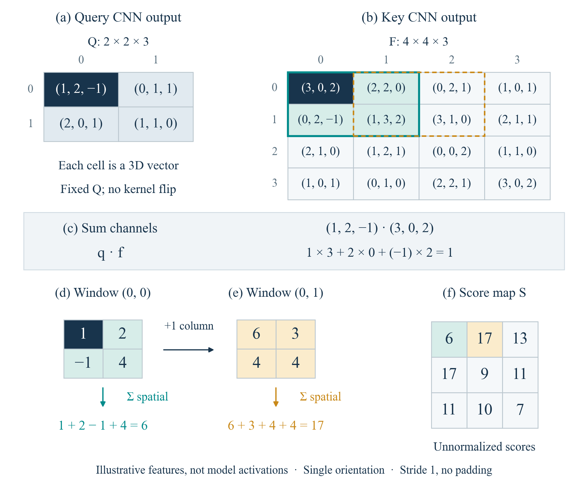

# 精修稿与教学代码索引

本索引根据仓库公开的[《具身操作泛化》精修稿](具身操作泛化_精修稿_20261011.pdf)整理。下文页码为该 35 页 PDF 的页码；该稿内部章号为第 9 章。复现代码主要覆盖 **9.2 Transporter Networks 技术解析**以及 **9.6 中已有的受控诊断**。精修稿的理论讨论范围大于代码实现范围。

运行入口与依赖见[复现教程](tutorial.zh-CN.md)，证据来源和样本量见[结果记录](results.md)。源码表中的 `ravens/...` 均相对于下载后生成的 `upstream/`，且只针对提交 `4752ffab487ebd387781ad7890aa540ae2780970`。

## 从数学关系到一次动作

| 精修稿位置 | 公式、图或表 | 代码入口 | 如何对照阅读 |
| --- | --- | --- | --- |
| 9.2.1，pp. 4–6，双位姿原语与条件动作分解 | 式 (9.2.1) 刚体补偿；式 (9.2.2)–(9.2.5) 动作空间、条件分解与贪心解码；图 9.2 | `ravens/agents/transporter.py` 的 `get_sample()`、`act()`；`ravens/tasks/primitives.py` | 抓点变化改变末端目标；训练用示范抓点，部署用预测抓点。两阶段贪心搜索不等价于遍历全部联合抓放动作 |
| 9.2.2，pp. 6–7，正交投影与空间等变性 | 式 (9.2.6)–(9.2.9) 相机/世界/网格；式 (9.2.10)–(9.2.13) 等变关系 | `ravens/utils/utils.py` 的 `get_fused_heightmap()`、`xyz_to_pix()`、`pix_to_xyz()`；Agent 的 `get_image()` | 明确 `(r,c)` 与 `(Y,X)`、3.125 mm/px、`320×160×6`。无限网格步长 1 的代数性质不等于有限网络的所有平移都严格等变 |
| 9.2.3，pp. 7–9，均值陷阱与密集评分图 | 式 (9.2.14)–(9.2.15)，例 9.2.1，图 9.3 | `teaching/scripts/toy_experiments.py` 的 `multimodal_experiment()`；`plot_toys.py` | 相同输入有四个标签时，直接坐标回归得到非法均值；自由 logits 可以保留四峰。是参数化教学例，不是 CNN 基准消融 |
| 9.2.4，pp. 8、10，动态查询核与深层互相关 | 式 (9.2.16)–(9.2.19)，图 9.4 | `ravens/models/transport.py` 的 `forward()`、`correlate()`；`teaching/scripts/plot_sliding_correlation.py` | Query 路径先旋转、裁剪，再编码；对应位置的通道内积再经窗口空间求和，构成一个分数。图中三通道数值是人工特征，不是真实激活 |
| 9.2.5，pp. 11–12，全局 Softmax 与梯度竞争 | 式 (9.2.20)–(9.2.26)，性质 9.2.2，图 9.5 | `ravens/models/attention.py`、`transport.py` 的 `train()`；`toy_experiments.py` 的 `gradient_experiment()` | 标签与输出被展平；对 logits 求导为 `p-y`，梯度代数和为零；参数梯度还要乘各 logit 的参数导数并求和 |

图 9.4 对应的三通道图可直接查看：

它同时揭示两种求和：`Σ_channel` 比较同一位置的特征向量，`Σ_spatial` 聚合整个局部几何模板。先看一个点的 `(1,2,-1)·(3,0,2)=1`，再看窗口的 `1+2-1+4=6`，最后看右移后的 17。完整评分图中有两个 17；这里还没有执行 Softmax。

## 从固定模型到可解释诊断

| 精修稿位置 | 公式、图或表 | 可运行入口与原始记录 | 解读边界 |
| --- | --- | --- | --- |
| 9.6.1，pp. 25–26，由受控变化定位机制 | 表 9.7 的“数学推导 / 合成算例 / 模型诊断 / 任务基准”分层 | `scripts/eval_pretrained.sh`；`teaching/scripts/model_diagnostics.py`；`evidence/historical/eval_pretrained.json` | 历史闭环仅 3 个种子，各一次动作成功；教学诊断重复同样种子，不增加独立样本数 |
| 9.6.2，pp. 26–27，抓点位移响应 | 式 (9.6.1)–(9.6.2)，表 9.8，图 9.9 | `model_diagnostics.py` 中 `conditioning`；`plot_diagnostics.py`；`teaching/results/model_metrics.json` | 同一图的三个抓点。目标物体真值姿态只用于构造几何参照；后两点没有机器人执行。4.42/8.84/3.13 mm 是量化网格上的预测偏差 |
| 9.6.3，pp. 28–29，一像素与八像素 | 式 (9.6.3) 采样相位，式 (9.6.4) TV；表 9.9，图 9.10 | `model_diagnostics.py` 的 `shift()` 和 `translation`；`plot_diagnostics.py` | 同步平移图像与抓点，空出区域补零；各边裁 32 像素，再对内部概率各自归一化。当前观测支持采样相位解释，不构成物理泛化基准 |
| 9.6.5，pp. 30–31，最小复跑闭环与代码定位 | 四个 Ravens 源码入口及运行次序 | `scripts/{setup,fetch_source,check_environment,fetch_assets,eval_pretrained,smoke_train}.sh`；`env.sh` | 教程补齐从全新克隆到环境、资产、推理和可选单步更新的步骤；单步训练是流程检查 |
| 配套技术解析的补充诊断 | Query/Key 输入敏感度图 | `model_diagnostics.py` 的梯度计算；`teaching/figures/model_sensitivity.png` | 选定特征平方范数的局部导数，不是区域遮挡实验，也不直接证明因果依赖 |

图 9.9 与图 9.10 使用的模型输入、预测数组和统计量分别保存在 `teaching/results/model_arrays.npz` 与 `model_metrics.json`。重绘脚本只改变显示方式，不重新训练模型。热图是沿方向取最大值后按完整响应峰值归一化的对数显示，不能当作概率边缘分布或跨图校准置信度。

## 哪些内容属于进一步学习，而非已实现实验

精修稿 pp. 1–4 的问题形式化，以及 9.3–9.5 的多模态基础模型、ReconVLA、世界模型、未来预测和跨具身迁移，提供更广的研究背景。本仓库没有相关模型、权重、训练管线或评估数据。

9.6.4 的最差组成功率、区域反事实干预、Brier 分数，以及表 9.10 的完整评测矩阵，是分析和后续实验设计方法。现有 Query/Key 输入梯度图不能替代区域干预；现有 3 个固定场景不能填充“未见对象 / 背景 / 视点”等分组，也不能推断最差组泛化。

如果以本仓库为起点扩展这些实验，应新增明确的实现和实验记录，写出对照组、环境变化、样本量、计算预算及随机种子。当前教程的继承与补充关系限于 Transporter Networks / Ravens 及其教学解释。
